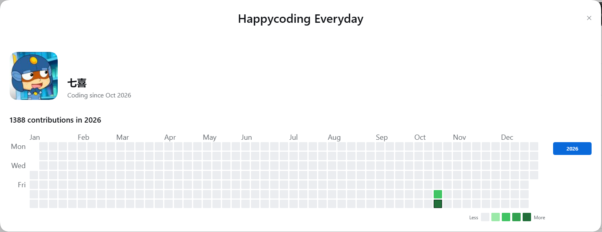
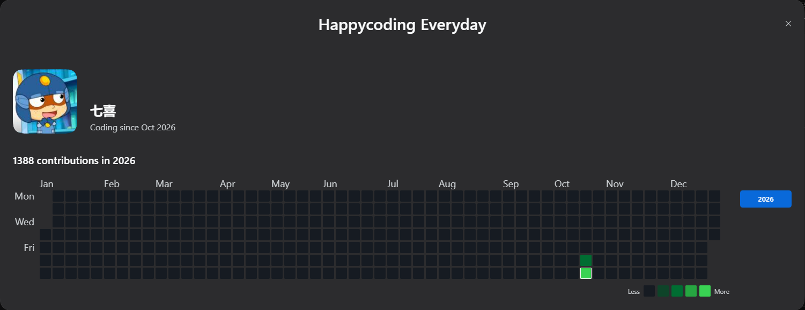

<p align="center">
  
</p>

<h1 align="center">Happycoding Everyday</h1>

<p align="center">
  把你在 DeepSeek Harness 的活动，画成 GitHub 风格的年度贡献热力图。<br>
  <a href="README.md">English</a> | 中文
</p>

<p align="center">
  <a href="screenshots/dialog-light.png"></a>
  <a href="screenshots/dialog-dark.png"></a>
</p>

*显示名 **Happycoding Everyday**；npm 包名、仓库名与插件 id 仍是 `dsh-happycode`。*

Happycoding Everyday 读取 DSH 本来就写在你自己机器上的会话日志，把每天的活动折算成一个数，
再用 GitHub 的那套画法画出来：横向是周、纵向是周一到周日、五档绿、每个格子都有 tooltip。
它是一个插件，不是一个服务 —— 数据不会离开这台机器。

## 安装

在 DSH 插件市场搜索 **Happycoding Everyday** 一键安装；或用命令行：

```sh
dsh plugin --profile <profile> add dsh-happycode
```

DSH Desktop 用户请在 **设置 → 插件** 里安装（那个 profile 归 App 管）。装完重启一次 DSH，
服务端半侧才会加载；客户端半侧刷新页面即可生效。

然后点左下角**头像菜单**，`HappyCode` 就夹在 **设置** 与 **意见反馈** 之间
—— 菜单用短名，弹窗里才是完整品牌语。

## 你会得到什么

- **账号菜单里的一行**：字号、行高、左右内边距、悬停态与相邻三项完全一致，前置一枚迷你热力格图标。
- **个人资料行**：约 120px 圆角头像 + 24px 间距 + 文字列（用户名 24px 加粗 / `Coding since Oct 2026` 16px），
  文字列底部与头像底部对齐。取数来自宿主已经渲染的账号按钮；没有头像就用品牌色圆角底 + 首字母；
  账号信息完全拿不到时整行不画。**不显示邮箱**——读到带 `@` 的文本一律当作「没有名字」。
- **与宿主设置同款的弹窗**：品牌语居中于 90px 标题带（28–30px 加粗，极窄时降到 24px），
  右上角可关，Esc 与点遮罩同样能关；宽度取 `min(1500px, 94vw)`，**高度随内容**，最多 88vh。
  垂直节奏：标题带↔资料行 40px、资料行↔总数标题 36px、底部 24px。
- **只有一个视图：自然年**。1 月到 12 月，周一起始，首末列补位留空，不会串进相邻年份。
- **图区铺满弹窗**：格子尺寸按卡片实测宽度算 —— 设计宽度下 21px、14px 下限，窗口缩放时重排。
- **坐标标签放大**：`Jan`…`Dec` 与 `Mon`/`Wed`/`Fri` 都是 18px。
- **图例在 GitHub 的位置**：卡片内部、格子正下方、右对齐。
- **卡片右侧的年份选择器**：当前年份 ∪ 有活动的年份，降序，最多 3 个。新年即使还没有活动，
  也保留一个按钮（跨年当天不会只剩旧年份）。
- **每个格子都有 tooltip**：`19 contributions on October 24th.`、`No contributions on October 23rd.`，
  措辞照抄 GitHub，日期带序数词。
- **深浅两套 GitHub 官方色阶**，跟随宿主主题实时切换。
- **可改的权重**：在 **插件** 页本插件自己的配置里，三个数字 + 一个 **Recalculate**。

## 统计口径

每天一个贡献值，由会话日志里的三类事件合成：

| 事件 | 权重 | 默认 |
|---|---|---|
| 你发出的消息（`user/message` 且来源是真实用户） | `m` | 1 |
| 工具调用（`tool/call`） | `t` | 1 |
| 写文件的工具调用（`write`、`edit`、`str_replace_editor` 等） | `f` | 3 |

`贡献值 = 1·m + 1·t + 3·f`

**不计入**：注入的上下文（运行时快照、技能目录、时间上下文）、助手消息、工具结果、
子智能体会话、空会话。规则与实测依据见 [docs/data-schema.md](https://github.com/luoyiyxo/dsh-happycode/blob/main/docs/data-schema.md)。

颜色分档按你自己的数据算：取**当前窗口**内非零贡献日的 25/50/75 分位数作为三个阈值。
活跃日少于 8 天，或分位数并列，则回退 GitHub 固定档位 `1–9 / 10–19 / 20–39 / 40+`。

## 隐私

- **零网络请求**：插件只和宿主自己的 loopback HTTP 路由通信，没有遥测、没有外链字体、没有头像拉取。
- **会话日志只读**：`~/.dsh/sessions/` 与投影缓存只读不写。
- **只写一个目录**：`~/.dsh/profiles/<profile>/.dsh-happycode/`，里面是 `daily.json`、`sessions.json`、`settings.json`。
- **不落任何会话内容**：诊断信息只有文件名、计数与错误消息。

## 兼容性

- DSH `0.2.1` 及以上（目标是账号菜单与插件配置页）。
- Node `22.15` 及以上，用于内置 Zstandard 解码；更低版本会跳过压缩日志并记录一条日志，不会崩。

## 工作原理

```
~/.dsh/sessions/<工作区>/session-<id>/session.v4.jsonl.zstd   （只读）
        │  拼接的 zstd 帧 → JSONL
        ▼
   daily.json  { "2026-10-24": { m: 8, t: 11, f: 0 } }        （缓存）
        │
        ▼
   GET /dsh-happycode/api/graph?year=2026   →  { total, days[], thresholds, … }
   GET /dsh-happycode/api/graph?range=last365   （留给后续路线图，当前 UI 不调用）
        │
        ▼
   客户端 bundle → 账号菜单行 → 弹窗
```

首次索引在后台跑完；之后只重新解析大小或修改时间变过的会话。单个会话解析失败就跳过并计入状态，
不重试、不致命。

## 开发

```sh
npm test                 # 53 个测试：解码、计数、缓存、路由、UI
npm run render:preview   # 用同一套网格几何重新生成 README 预览图
```

客户端 bundle 是手写的 CommonJS（`client/client.js`），没有构建步骤：它自己注册到宿主的
`window.__ModuleLoader__`，只从宿主 module table 里 `require` `react` 与
`@deepseek-ai/dsh-client-ui-primitives`。

账号菜单那一行是怎么塞进去的、为什么只能这么塞，见 [docs/host-ui-notes.md](https://github.com/luoyiyxo/dsh-happycode/blob/main/docs/host-ui-notes.md)。

## 许可证

MIT。
